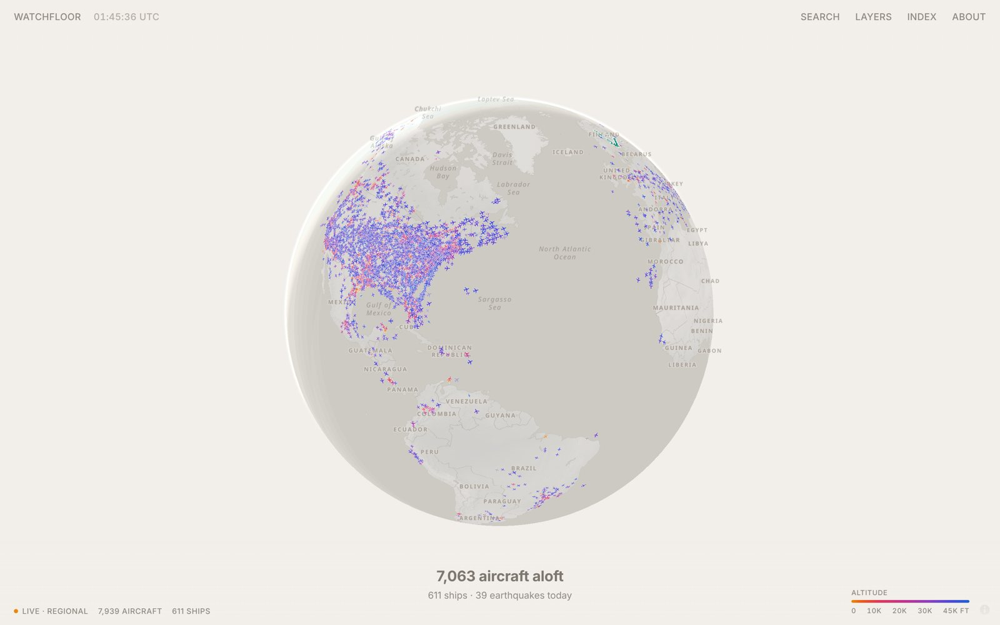
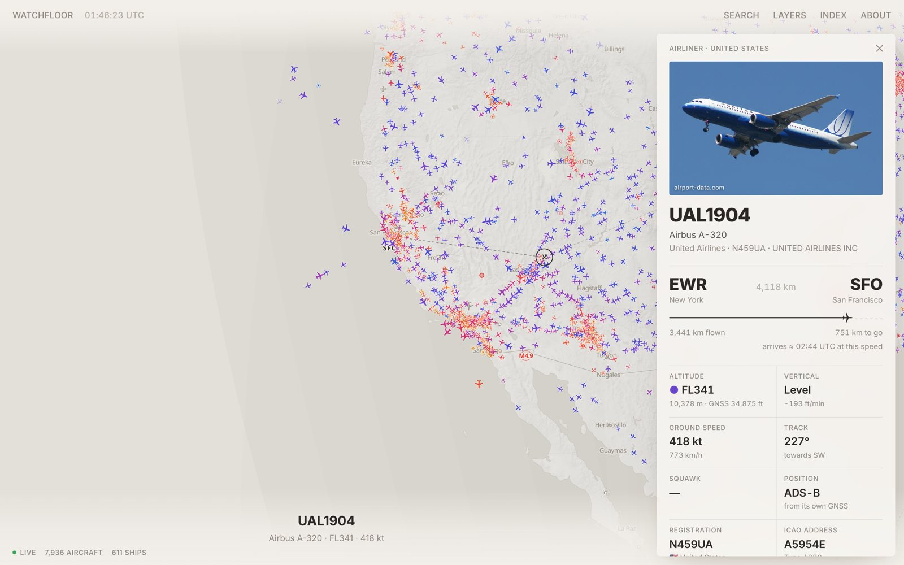
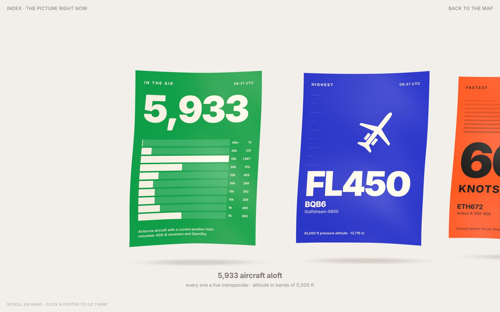

# Watchman

A live picture of the planet's traffic, drawn like a printed chart on warm paper: every aircraft a volunteer receiver can hear, ships reporting over AIS, earthquakes as they happen, disasters with an alert level, and the space station overhead.



Nothing is simulated, and nothing is guessed. Every number on screen comes from a named source, says how old it is, and is left out when it can't be checked.



## What's in it

**The map.** A MapLibre globe that turns flat as you zoom in, styled on OpenFreeMap tiles as a paper chart: washed-out shaded relief, quiet borders, grey type. Traffic is the only colour on the page.

- **Aircraft**, drawn as top-down silhouettes by type (airliner, wide-body, business jet, light aircraft, helicopter, fast jet, glider, drone), pointing along their track and coloured by altitude from amber near the ground to deep blue above 40,000 ft.
- **Ships**, teal when under way and pale when moored or at anchor.
- **Earthquakes** (USGS) as rings sized by magnitude, fading with age; fresh ones pulse.
- **Disasters** (GDACS): cyclones, floods, volcanoes, droughts and wildfires with orange or red alerts.
- **The ISS** with its ground track 45 minutes back and ahead.
- **Day and night**: the terminator plus civil, nautical and astronomical twilight, in 3° bands.
- **Weather radar** (RainViewer), **airports** (3,300 with scheduled service) and **callsign labels**.

**What the aircraft itself says.** Many airliners broadcast far more than position, and Watchman shows it: the altitude and heading set on the autopilot and whether it is climbing to it, the autopilot modes engaged (LNAV, VNAV, approach, TCAS), indicated and true airspeed and Mach, bank angle and turn rate, the altimeter setting, outside air temperature against the standard atmosphere, the wind it is flying through split into headwind and crosswind, and how accurate its position is.

**Winds aloft** (`W`). Thousands of aircraft report the wind they measure; drawn together they show the jet streams live, with arrows that point downwind and grow and darken with speed. The Index has a jet stream poster with the strongest wind being measured anywhere.

**Airport weather.** Click an airport for its latest METAR from NOAA's Aviation Weather Center, decoded: flight category, wind, visibility, cloud, temperature, dew point and pressure, alongside arrivals and departures on the map.

**Ships, in depth.** Registry particulars (year built, gross tonnage, deadweight, registry and home port, nearest town) and the last day of track from Open Waters, plus photos and class from Wikidata.

**The details sheet.** Click anything. For an aircraft: a photo of the actual airframe with the photographer's credit, its type, operator and registration, the country of registration from its ICAO address, the route with a progress bar, distance flown and to go and an arrival estimate, altitude (pressure and GNSS), vertical rate, ground speed, track, squawk, how its position was obtained (ADS-B, MLAT or TIS-B), report age, and an altitude and speed profile of its flight so far. For a ship: type, flag, destination and ETA, size, draught, rate of turn, and a photo and particulars from Wikidata when it has an IMO entry. Airports show live arrivals, departures and whether it is day or night there; earthquakes show depth, felt reports, tsunami flag and PAGER alert.

**The Index** (`I`). The picture right now, as posters: aircraft aloft by altitude band, the highest and fastest aircraft, emergency squawks, the strongest earthquake of the week, the past day's quakes on a world map, where the sun is rising and setting, the ISS, ships under way, the busiest approach, military traffic, disaster alerts. They hang on cloth in WebGL, ripple, and bend as you scroll or drag through them. Click one to fly there.



**Search** (`/` or Ctrl K) finds aircraft by callsign, registration, ICAO address, squawk or type; ships by name, MMSI, IMO or destination; airports by code, name or city; earthquakes by place.

**Alerts** appear when an aircraft squawks 7500, 7600 or 7700 (once a second report confirms it) or a magnitude 5.5+ earthquake strikes.

## Accuracy

This is where most of the work went.

- **Tracks never jump backwards.** The aggregator merges every feed by ICAO address or MMSI and only moves a track when a report's position time is newer than the one it holds, so a slow worldwide poll can't drag a plane back to where it was a minute ago.
- **Dead reckoning along great circles**, at reported ground speed and track, for as long as the feed's report interval justifies: 45 s for a local receiver feed that reports every few seconds, a little more than the polling interval for the worldwide feed. When the next report lands, the gap is closed over a second instead of snapping. Tracks fade once overdue and the details sheet says how far ahead of its last report a symbol is drawn.
- **Routes are verified before they are shown.** Route databases map a callsign to the route it usually flies and are often wrong. The aircraft has to be inside a corridor around the great circle between the two airports (widening with route length, since long flights ride or dodge jet streams) and not heading away from the destination. If it isn't, the sheet says which route was on file and why it was rejected.
- **Real types for every aircraft.** OpenSky doesn't send aircraft types, so the server loads the tar1090 airframe database (620,000 entries: registration, type, model, operator, military flag) and fills them in.
- **Headlines are checked.** The Index only names the highest or fastest aircraft when its type is known and its numbers are plausible (barometric and GNSS altitude agree, no multilaterated speed).
- **Bad data is filtered**: ground vehicles and tower beacons, positions older than a minute, garbled jumps faster than Mach 3, AIS "not available" values (speed 102.3, course 360, heading 511, rate of turn −128).
- **Solar position** uses the NOAA algorithm and agrees with an independent implementation to 0.01°. The ISS's sunlight takes its altitude into account (it sees the sun about 20° past the ground terminator).
- **Coverage is stated honestly.** Volunteer receivers cover Europe and North America densely and oceans, much of Africa and Central Asia thinly. The About page lists every source with its live status.

`npm test` covers the geodesy, solar position, ADS-B and AIS/NMEA parsing, merging, emergency confirmation, approximate military positions, route verification and estimated positions.

## Deploy

[](https://render.com/deploy?repo=https://github.com/ahroonsanthosh/coolshi)

Watchman needs a small always-on Node server (most of its sources don't allow direct browser requests), so it can't run on static hosting like GitHub Pages. The button above deploys `render.yaml` to Render's free tier; any container host works with the `Dockerfile`. On Render's free plan the service sleeps after 15 minutes without visitors and takes about a minute to wake.

## Running it

Requires Node.js 22.18 or newer (the server is TypeScript run directly by Node).

```bash
npm install
```

```bash
npm run dev
```

Open http://localhost:5173. The aggregator runs on port 8080 and Vite proxies `/api` to it.

For production, one process on one port:

```bash
npm run build
```

```bash
npm start
```

Then open http://localhost:8080. On first start the server downloads the aircraft database (8 MB) into `.cache/` and refreshes it weekly.

### Configuration

Everything is optional; copy `.env.example` to `.env`.

| Setting | What it does |
| --- | --- |
| `OPENSKY_CLIENT_ID`, `OPENSKY_CLIENT_SECRET` | A free OpenSky account raises the daily allowance from 400 to 4,000 credits. A worldwide poll costs 4, so anonymous access gives about four hours of world view a day at the default 150 s interval; an account keeps it live most of the day at 45 s. Polling only runs while someone is watching. |
| `OPENSKY_POLL_S` | Seconds between worldwide polls. |
| `OPENWATERS_TOKEN` | Ships already come worldwide from Open Waters without a key; a free personal token raises its rate limits. |
| `AISSTREAM_API_KEY` | A second worldwide ship stream from AISStream (free key at aisstream.io). |
| `PORT`, `HOST` | Port and bind address for the aggregator and the built site (default `8080` on `0.0.0.0`). |
| `OPENSKY=off`, `OPENWATERS=off`, `KYSTVERKET=off` | Turn a feed off, for example on a host that a network refuses. |

### Free coverage, no keys

Without any keys, Watchman combines:

- **OpenSky** for a worldwide aircraft snapshot (anonymous allowance).
- **A worldwide sweep** across four volunteer ADS-B networks (adsb.fi, adsb.lol, airplanes.live, adsb.one): 349 circles of 250 nm placed wherever there are scheduled airports, busiest airspace every two minutes, the rest every five, each network kept under its published rate limit. It fills what OpenSky misses and carries the whole picture when OpenSky's credits run out (the status line then says `Live · regional`).
- **Estimated positions beyond receiver range**, the way commercial trackers fill the oceans. When an airliner at cruise falls silent and its filed route is confirmed by its position and heading (within 30° of the destination), it is carried along the great circle to its destination at its last ground speed until about 20 minutes out, when receivers there should hear it again. Estimates are drawn as faded ghosts, labelled everywhere, kept out of every live count and headline, and replaced by the first real report.
- **Worldwide by aircraft type.** adsb.lol, airplanes.live and adsb.one answer "every aircraft of this type, anywhere" in one request, so the server asks for up to 150 of the most common types (ranked from live traffic), plus military types, every few minutes. In testing that added about 15–20% more aircraft than the circle sweep alone.
- **Military aircraft** from every network's military list each cycle (each hears different traffic), worldwide queries for military types (tankers, transports, patrol, AWACS, helicopters), and flagged by the airframe database, by types only air forces fly, and by the ICAO address blocks states reserve for military use. Military aircraft that answer radar with Mode S but broadcast no position are shown too, as rings at the rough area of the receivers hearing them, clearly marked approximate (they can be off by a hundred kilometres or more), with fast jets and bombers (F-16, F-15, F/A-18, F-35, F-22, B-1, B-2, B-52, Eurofighter, Rafale, Gripen, Hawk, M-346) searched for by type worldwide. Press `M` to show only military. Only aircraft that transmit something can be shown; most combat sorties don't.
- **Your view**, refreshed every five seconds from the same networks, plus worldwide military aircraft and emergency squawks.
- **Ships worldwide** from Open Waters AIS, an open network that merges government feeds, AISHub, aisstream.io and volunteer receivers and needs no key: the server sweeps the world's seas in 10° boxes (busy ones every 3 minutes, empty ones hourly) within its anonymous limits, and polls whatever you are looking at every 20 seconds. Plus Fintraffic (Baltic) and Kystverket (Norway) directly. Around 40,000 ships within two minutes of starting; the browser receives only those in view (up to 12,000). An optional free token (`OPENWATERS_TOKEN`) raises the limits.

An AISStream key (`AISSTREAM_API_KEY`) adds a second worldwide ship stream. Some networks refuse requests from cloud servers; a refused feed backs off for an hour and the About page shows it, so check there after deploying.

## How it works

```
OpenSky (world snapshot) ──────────┐
adsb.fi / adsb.lol /               │
  airplanes.live / adsb.one        │
  (your view, worldwide sweep,     ├─► server/store.ts ─► /api/air     (deltas) ─┐
  types, military, squawks) ───────┤    merge by address, /api/sea               │
Open Waters, Fintraffic,           │    newest position   /api/world             ├─► browser: dead reckoning,
  Kystverket, AISStream (AIS) ─────┤    wins, history     /api/winds, /api/metar │   MapLibre globe, panels,
USGS, GDACS, ISS, NOAA METAR ──────┘                      /api/detail, /history ─┘   three.js Index
tar1090 aircraft database ─────────► types, registrations, military flag
server/estimates.ts ───────────────► positions beyond receiver range
```

- `server/` the aggregator: `feeds/` (one module per source), `store.ts` (the merged picture), `estimates.ts` (positions beyond receiver range), `aircraftDb.ts` (the airframe database), `grid.ts` (the worldwide sweep), and `index.ts` (scheduling and HTTP). Each browser reports what it is looking at, and the ADS-B networks are asked about those areas, paced to their published limits (adsb.fi one request a second; the others more gently). Viewer areas, military lists and emergency squawks are scheduled ahead of the worldwide sweeps. `/healthz` reports counts and the status of every source.
- `shared/` geodesy, solar position and the wire format, used by both sides.
- `src/` the client: `map/` (style, icons, layers, render loop), `state/` (app state, data polling, winds aloft), `ui/` (sheet, search, layers, about), `gallery/` (posters and the cloth renderer), `lib/` (aircraft and AIS tables, enrichment, formatting), `data/` (airports, countries, coastline, military address blocks). `npm run airports` rebuilds the airport list from OurAirports.

Photos (Planespotters), airframes and routes (adsbdb), ship particulars (Wikidata) and radar (RainViewer) are fetched by the browser on demand; airport weather and ship registry details go through the server.

## Keys

| Key | Action |
| --- | --- |
| `/`, Ctrl K | Search |
| `I` | Index |
| `L` | Layers and filters |
| `M` | Military aircraft only |
| `W` | Winds aloft |
| `F` | Follow the selected track |
| `G` | Back to the whole globe |
| `R` / `N` / `A` / `E` / `T` | Radar / day and night / airports / earthquakes / trail |
| `Esc` | Close, or clear the selection |

Links like `/#a:a5954e` (aircraft) or `/#s:230123456` (ship) open with that track selected.

## Data and credits

Open Waters AIS (openwaters.io); AISHub; BarentsWatch (NLOD); OpenSky Network; adsb.fi; adsb.lol; airplanes.live; adsb.one; Fintraffic Digitraffic (CC BY 4.0); Kystverket, Norwegian Coastal Administration (NLOD); AISStream; USGS; GDACS (European Commission, UN); wheretheiss.at; RainViewer; Planespotters.net (photos credited to their photographers); adsbdb; NOAA Aviation Weather Center; Wikidata and Wikimedia Commons; tar1090-db (Mictronics, wiedehopf); OurAirports (public domain); ICAO Annex 10 address blocks; ITU maritime identification digits; OpenFreeMap, OpenMapTiles and © OpenStreetMap contributors; Natural Earth.
